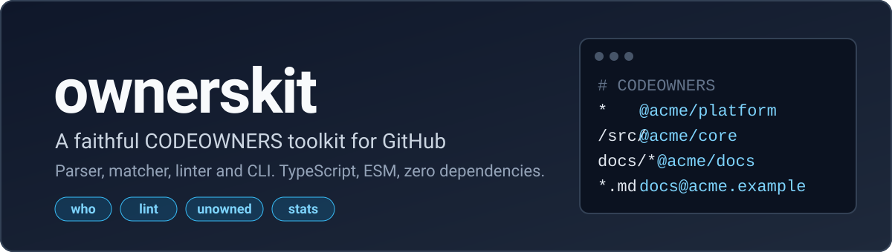
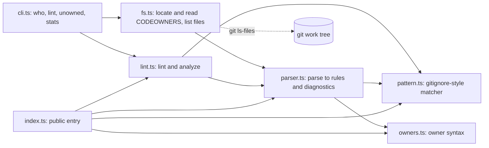

<p align="center">
  
</p>

<p align="center">
  <a href="LICENSE"></a>
  
  
  
  
</p>

<p align="center">
  <a href="#why">Why</a> &middot;
  <a href="#quick-start">Quick start</a> &middot;
  <a href="#demo">Demo</a> &middot;
  <a href="#cli">CLI</a> &middot;
  <a href="#api">API</a> &middot;
  <a href="#architecture">Architecture</a> &middot;
  <a href="#limitations">Limitations</a> &middot;
  <a href="#testing">Testing</a> &middot;
  <a href="#roadmap">Roadmap</a>
</p>

# ownerskit

`ownerskit` is a typed CODEOWNERS toolkit for Node.js: a parser and matcher library, plus a CLI that
answers "who owns this file?", lints the CODEOWNERS file, lists files that have no owner and counts
files per owner. It follows the rules GitHub documents for CODEOWNERS, with an optional GitLab dialect.

## Why

CODEOWNERS looks like `.gitignore` but is not. `docs/*` is not recursive, `!` negation and `[abc]`
character classes are not supported, paths are case-sensitive, the last matching rule wins, and a rule
with no owner removes ownership. GitHub skips lines it cannot parse, so a typo can quietly leave code
without a reviewer. `ownerskit` lets you catch those problems locally, in CI and offline, before you
push, and lets scripts ask ownership questions without calling the GitHub API.

### What it does

- **Answers ownership questions**: which owners apply to a path, and which line decided it.
- **Lints with knowledge of your repository**: syntax errors, malformed owners, rules that can never
  apply, patterns that match no tracked file, rules fully overridden by later rules.
- **Reports coverage**: files without an owner, and files per owner.
- **Works in CI**: `--json` output, stable exit codes, file list taken from `git ls-files`.
- **Optionally speaks GitLab**: `[Section]` headers, default owners, optional sections.

### Verified features

Everything below is exercised by the test suite or was run for this README (see [Testing](#testing)).

- Parser and matcher with the gitignore-style semantics documented by GitHub (table in
  [Pattern semantics](#pattern-semantics)).
- 13 lint rules (see [Lint rules](#lint-rules)).
- Four CLI commands: `who`, `lint`, `unowned`, `stats`, with `--json`.
- GitLab dialect: sections, default owners, `^[Optional]`, `[Section][2]`.
- Configurable handling of malformed owners (`invalidOwners`, see [Limitations](#limitations)).
- Zero runtime dependencies: `package.json` declares only `devDependencies` (TypeScript and
  `@types/node`).
- The main entry point imports no Node.js modules; only `ownerskit/fs` and the CLI use `node:` APIs.
- No network access in the source.

## Quick start

`ownerskit` is **not published to npm** yet, so install it from a clone. It requires Node.js 22 or
later and `git`.

```sh
git clone https://github.com/Emincanozen/ownerskit.git
cd ownerskit
npm install        # installs dev tooling and builds dist/ (the "prepare" script)
npm test           # optional: compile and run the test suite
node dist/cli.js --version
```

Run it against any git repository that has a CODEOWNERS file:

```sh
node dist/cli.js lint -C /path/to/your/repo
node dist/cli.js who src/index.ts -C /path/to/your/repo
```

Paths given to `who` are resolved relative to your current directory; `-C` selects the repository root.

## Demo

The output below was produced by running the real CLI (version 0.1.0) in a small demonstration
repository with 15 tracked files and the CODEOWNERS file shown first. Nothing was edited by hand.

`.github/CODEOWNERS`:

```text
# Default owner for everything
*                   @acme/platform

/src/api/           @acme/backend
/src/ui/            @acme/frontend @alice
/src/legacy/        @acme/backend
/src/               @acme/core
docs/*              @acme/docs
*.md                docs@acme.example
/Scripts/           @acme/devops
!*.lock             @acme/platform
*.sql               dbateam
```

```console
$ ownerskit who src/api/server.ts docs/guide.md docs/api/reference.md scripts/deploy.sh
src/api/server.ts      @acme/core  [line 7: /src/]
docs/guide.md          docs@acme.example  [line 9: *.md]
docs/api/reference.md  docs@acme.example  [line 9: *.md]
scripts/deploy.sh      @acme/platform  [line 2: *]
[exit 0]
$ ownerskit lint
.github/CODEOWNERS:4:1  warning  shadowed-rule  Rule "/src/api/" matches 2 file(s) but later rules override all of them, mostly by "/src/" on line 7
.github/CODEOWNERS:5:1  warning  shadowed-rule  Rule "/src/ui/" matches 2 file(s) but later rules override all of them, mostly by "/src/" on line 7
.github/CODEOWNERS:6:1  warning  shadowed-rule  Rule "/src/legacy/" matches 1 file(s) but later rules override all of them, mostly by "/src/" on line 7
.github/CODEOWNERS:8:1  warning  shadowed-rule  Rule "docs/*" matches 2 file(s) but later rules override all of them, mostly by "*.md" on line 9
.github/CODEOWNERS:10:1  warning  no-match  Pattern "/Scripts/" does not match any file (a file matches when ignoring case; CODEOWNERS paths are case-sensitive)
.github/CODEOWNERS:11:1  error    negation-unsupported  Negation is not supported in CODEOWNERS: "!*.lock" (line ignored)
.github/CODEOWNERS:12:21  error    invalid-owner  Invalid owner "dbateam": expected @user, @org/team or an e-mail address (owner ignored, the rest of the line applies)

2 error(s), 5 warning(s)
[exit 1]
$ ownerskit unowned
schema.sql
1 of 15 file(s) have no owner
[exit 1]
$ ownerskit stats
OWNER              FILES      %
@acme/core             6   40.0
@acme/platform         4   26.7
docs@acme.example      4   26.7

15 files, 14 owned (93.3%), 1 unowned
[exit 0]
```

The `[exit N]` lines were added to show each exit code; the tool does not print them. The demo
CODEOWNERS file is deliberately flawed: `/src/` placed after the more specific rules overrides them all.

## CLI

```text
ownerskit who <paths...>   Show the owners of each path
ownerskit lint             Check the CODEOWNERS file for problems
ownerskit unowned          List repository files that have no owner
ownerskit stats            Count files per owner

Options:
  -f, --file <path>      CODEOWNERS file to use (default: first of
                         .github/CODEOWNERS, CODEOWNERS, docs/CODEOWNERS)
  -C, --root <dir>       Repository root (default: git top-level, else cwd)
      --dialect <name>   github (default) or gitlab
      --json             Print machine-readable JSON
      --untracked        Also consider untracked, non-ignored files
      --no-git           Walk the file system instead of using git ls-files
      --strict           lint: treat warnings as errors
      --invalid-owners <policy>
                         ignore-owner (default): drop malformed owners, keep
                         the line; skip-line: ignore lines naming one
```

Files are listed with `git ls-files` (tracked files, which is what pull requests are made of). Outside
a git work tree, or with `--no-git`, the file system is walked instead, skipping `.git` and
`node_modules`.

### Exit codes

| Code | Meaning |
|---|---|
| 0 | Success, nothing to report |
| 1 | Findings: lint errors (or warnings with `--strict`), unowned files, or a `who` path without owner |
| 2 | Usage error, unreadable file, or no CODEOWNERS file found |

With `--json`, errors are JSON too, printed on stdout with exit code 2:

```json
{ "error": { "code": "no-codeowners", "message": "no CODEOWNERS file found in ..." } }
```

Error codes: `usage`, `no-codeowners`, `read-error`, `root-not-found`.

Example CI steps, assuming `ownerskit` was cloned and built next to the repository under test:

```yaml
- run: node path/to/ownerskit/dist/cli.js lint --strict
- run: node path/to/ownerskit/dist/cli.js unowned   # fails the job if any tracked file has no owner
```

### Lint rules

| Code | Severity | Needs files | What it means |
|---|---|---|---|
| `negation-unsupported` | error | no | `!pattern` is not supported; the line is ignored |
| `character-class-unsupported` | error | no | `[abc]` is not supported by GitHub; the line is ignored |
| `escaped-hash-unsupported` | error | no | GitHub does not support `\#` to escape a leading `#` |
| `invalid-pattern` | error | no | The pattern names no path (`/`), or has three or more consecutive `*`; the line is ignored |
| `invalid-owner` | error | no | Not `@user`, `@org/team` or an e-mail address; never returned as an owner |
| `invalid-section` | error | no | Malformed GitLab section header |
| `file-too-large` | error | no | GitHub ignores CODEOWNERS files of 3 MB or more |
| `duplicate-owner` | warning | no | The same owner appears twice on a line |
| `duplicate-pattern` | warning | no | The same pattern appears later, so this rule never applies |
| `unreachable-rule` | warning | no | A later catch-all (`*`, `**`, `/**`, `**/*`, `/**/*`) overrides this rule |
| `multiple-codeowners-files` | warning | no | Several CODEOWNERS files exist; only the first is used |
| `no-match` | warning | yes | The pattern matches no file (with a hint when only the case differs) |
| `shadowed-rule` | warning | yes | The rule matches files, but a later rule wins for every one of them |

## Pattern semantics

`ownerskit` follows GitHub's documentation. Every row below is covered by the test suite.

| Pattern | Matches | Does not match |
|---|---|---|
| `*` | every file | |
| `*.js` | `a.js`, `src/deep/a.js` | `a.jsx` |
| `/build/logs/` | `build/logs/a.log`, `build/logs/x/y.log` | `src/build/logs/a.log` |
| `docs/*` | `docs/getting-started.md` | `docs/build-app/troubleshooting.md`, `src/docs/a.md` |
| `apps/` | `apps/x`, `packages/apps/x` | `myapps/x`, a file named `apps` |
| `/docs/` | `docs/a.md`, `docs/guides/b.md` | `packages/docs/a.md` |
| `**/logs` | `logs/a`, `build/logs/a`, `deeply/nested/logs/a` | `catalogs/a` |
| `logs/**` | `logs/a`, `logs/a/b` | `build/logs/a` |
| `a/**/b` | `a/b`, `a/x/y/b` | `a/xb` |
| `src/app` | `src/app`, `src/app/main.ts` | `lib/src/app`, `src/apple` |
| `README.md` | `README.md`, `docs/README.md` | `readme.md` (case-sensitive) |
| `my\ file.txt` | `my file.txt` | |

Rules of thumb:

- A pattern without a slash (except a trailing one) matches at any depth.
- A leading or middle slash anchors the pattern to the repository root.
- A trailing slash matches directory contents only.
- A pattern that matches a directory also owns everything inside it, **except** `dir/*`, which only
  owns direct children (this is where CODEOWNERS and gitignore differ).
- The last matching rule wins. A rule with no owners makes matching files unowned.
- `!` negation and `[...]` character classes are not supported; such lines are reported and ignored.
- Three or more consecutive asterisks are invalid (GitHub's
  ["List CODEOWNERS errors"](https://docs.github.com/en/rest/repos/repos#list-codeowners-errors)
  example reports `***/*.rb` as an "Invalid pattern"); the line is ignored.
- `**` inside a segment (`foo**bar`) is treated like `*`, as in gitignore. GitHub does not document
  this case.
- A token starting with `#` begins a comment, also after the owners.
- Matching uses no regular expressions and cannot backtrack exponentially: each test costs at most
  O(pattern length x path length).

### GitLab dialect (`--dialect gitlab`)

- `[Section]`, `^[Optional section]`, `[Section][2]` headers, optionally followed by default owners.
- Rules without owners inherit the section's default owners.
- Each section is evaluated separately (last match per section); a file's owners are the union across
  sections. Sections whose names differ only by case are merged.
- Owners may be `@user`, `@group/subgroup`, `@@developer`/`@@maintainer`/`@@owner`, or e-mail addresses.
- `\#` escapes a leading `#`.
- Not implemented: `!` exclusions inside sections, and GitLab-specific path rules beyond the shared
  gitignore-style semantics above.

## API

```ts
import { parse, lint, analyze, ownersOf } from 'ownerskit';
import { loadCodeowners, listRepoFiles } from 'ownerskit/fs';

const co = parse(content); // or parse(content, { dialect: 'gitlab' })

co.ownersOf('src/index.ts');     // ['@acme/backend']
co.match('src/index.ts');        // { path, owners, rules: [Rule] }
co.rules;                        // valid rules, in file order
co.diagnostics;                  // syntax problems found while parsing

ownersOf(content, 'src/index.ts'); // one-shot helper

const { files } = listRepoFiles(process.cwd());
lint(co, { files });             // Diagnostic[] sorted by line
analyze(co, files);              // { matches, unowned, owners: [{ owner, files }] }

const loaded = loadCodeowners(process.cwd()); // finds .github/, root, docs/ in that order
```

Because the package is not on npm yet, depend on your clone (for example with a `file:` dependency);
`ownerskit` above is the package name.

### Main entry (`ownerskit`)

- `parse(content, { dialect?, caseSensitive?, invalidOwners? }): Codeowners` never throws on bad
  input; invalid lines end up in `diagnostics` and are skipped.
- `Codeowners`: `dialect`, `rules`, `sections`, `diagnostics`, `match(path)`, `ownersOf(path)`.
- `Rule`: `index`, `line`, `pattern`, `owners` (effective), `explicitOwners`, `invalidOwners`,
  `section`, `comment`, `matcher`.
- `lint(codeowners, { files?, sizeBytes? }): Diagnostic[]`.
- `analyze(codeowners, files): OwnershipReport`.
- `compilePattern(pattern, { caseSensitive? }): CompiledPattern` with `test(path)`, `anchored`,
  `directoryOnly`, `recursive`, `caseSensitive`. Throws `PatternError` on invalid patterns.
- `normalizePath(path)`, `classifyOwner(owner, dialect?)`, `isValidOwner(owner, dialect?)`.
- `Diagnostic`: `{ code, severity: 'error' | 'warning', message, line, column }`. `line` and `column`
  are 1-based; 0 means a file-level finding.

Paths passed to `match` and `ownersOf` are repository-relative with forward slashes. Leading `./` and
`/` are stripped. Backslashes are kept, since they are valid in POSIX file names; convert Windows
paths yourself.

### Node.js helpers (`ownerskit/fs`)

- `GITHUB_LOCATIONS`, `GITLAB_LOCATIONS`, `codeownersLocations(dialect)`.
- `findCodeownersFiles(root, dialect?)`: existing locations, in priority order.
- `loadCodeowners(root, { dialect?, file?, caseSensitive?, invalidOwners? })`: reads and parses, or returns `null`.
- `listRepoFiles(root, { untracked?, noGit? })`: `{ files, source: 'git' | 'walk' }`.
- `findGitRoot(cwd)`.

## Architecture



`index.ts`, `parser.ts`, `pattern.ts`, `owners.ts`, `lint.ts` and `types.ts` import no Node.js modules.
Only `fs.ts` (file system, `git`) and `cli.ts` do.

## Limitations

- **Malformed owners are an undocumented corner of GitHub's behaviour.** A malformed owner such as
  `bob` (no `@`, not an e-mail address) is reported as `invalid-owner` and is never returned by
  `ownersOf`, `unowned` or `stats`. GitHub's documentation says an owner that does not exist or lacks
  access "will not be assigned", and separately that lines with invalid syntax are skipped; it does not
  say which applies to a malformed owner. The behaviour is therefore configurable, and you should treat
  it as uncertain:
  - `invalidOwners: 'ignore-owner'` (default, CLI `--invalid-owners ignore-owner`) drops the owner and
    keeps the rest of the line, so `*.js bob` makes `.js` files unowned.
  - `invalidOwners: 'skip-line'` ignores the whole line, so an earlier rule applies.

  Dropped owners stay available in `rule.invalidOwners`.
- Owners are checked for syntax only. Whether a user or team exists and has write access can only be
  checked by GitHub or GitLab.
- GitHub's handling of `foo**bar` is not documented; `ownerskit` treats it like `*`.
- `shadowed-rule` and `no-match` compare every rule with every file: O(rules x files) pattern tests.
  That has not been benchmarked on very large monorepos.
- Static `unreachable-rule` detection only recognizes catch-all patterns; other overlaps are found by
  the file-based `shadowed-rule` check.
- GitLab support covers sections and owners, not every GitLab-specific extension.
- Version 0.1.0, not published to npm. A GitHub Actions workflow is provided in
  `.github/workflows/ci.yml` (typecheck, build, tests and a CLI smoke test on Linux, Windows and macOS).

## Comparison with existing npm packages

Facts below come from the npm registry (checked on 2026-11-18) and say nothing about quality.

| Package | Latest dist-tag | Release date | Repository |
|---|---|---|---|
| [`codeowners`](https://www.npmjs.com/package/codeowners) | 5.1.1 | 2021-06-17 | [beaugunderson/codeowners](https://github.com/beaugunderson/codeowners) |
| [`github-codeowners`](https://www.npmjs.com/package/github-codeowners) | 0.2.1 | 2020-08-23 | [jjmschofield/github-codeowners](https://github.com/jjmschofield/github-codeowners) |
| [`codeowners-utils`](https://www.npmjs.com/package/codeowners-utils) | 1.0.2 | 2020-04-29 | [jamiebuilds/codeowners-utils](https://github.com/jamiebuilds/codeowners-utils) |
| [`@nmann/codeowners`](https://www.npmjs.com/package/@nmann/codeowners) | 2.1.1 (`next`: 3.0.0-alpha.1) | 2025-08-26 (`next`: 2025-12-13) | [noahm/codeowners](https://github.com/noahm/codeowners) |

- `ownerskit` is not a drop-in replacement: the API is different, so code written against one of
  these packages needs adapting.
- `ownerskit` is new and has no track record. These packages have users and history that it lacks.
- GitHub itself validates CODEOWNERS server-side (the
  ["List CODEOWNERS errors"](https://docs.github.com/en/rest/repos/repos#list-codeowners-errors)
  REST endpoint) and is the authority on what it accepts, including whether users and teams exist.
  `ownerskit` works locally and offline and cannot check those things.

## Testing

```sh
npm run typecheck
npm run build
npm test
```

Last real run (Node.js v22.14.0, Windows 11, 2026-11-18, before export): `npm run typecheck` and
`npm run build` clean; `npm test` reports **274 tests in 53 suites, 274 passed, 0 failed**, in about
2.7 seconds. The tests use Node's built-in `node:test` runner, so there is no test framework dependency.

## Roadmap

Ideas, not promises:

- Consider an npm release in the future.
- Benchmark `shadowed-rule` and `no-match` on large repositories.
- Broader static overlap detection beyond catch-all patterns.
- More GitLab extensions.
- Optional machine-readable output formats for annotation tools.

## Contributing

Issues and pull requests are welcome: see [CONTRIBUTING.md](CONTRIBUTING.md). Security problems go through [SECURITY.md](SECURITY.md). Changes are listed in [CHANGELOG.md](CHANGELOG.md).

## License

[MIT](LICENSE).
